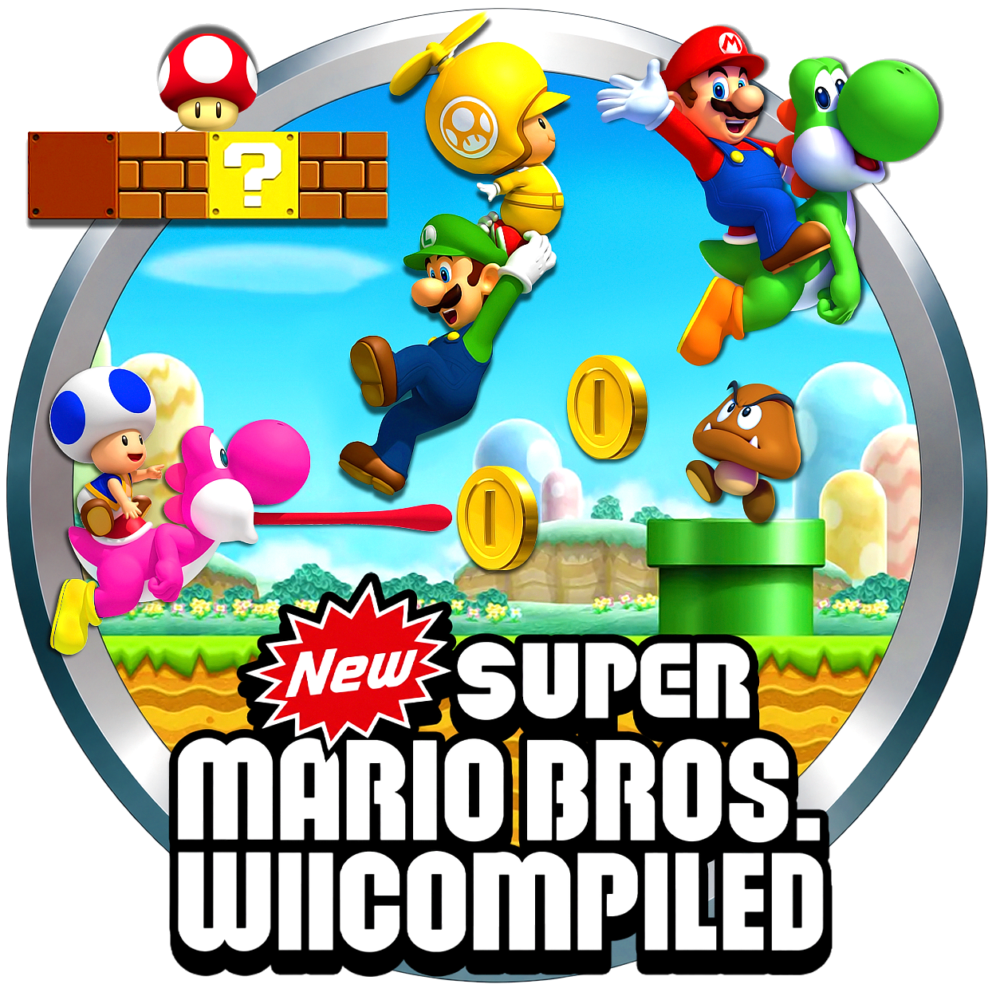
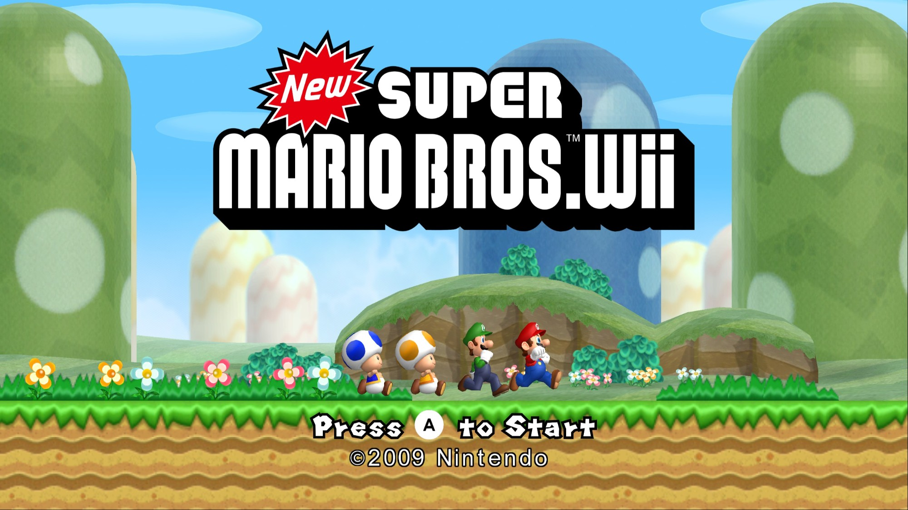
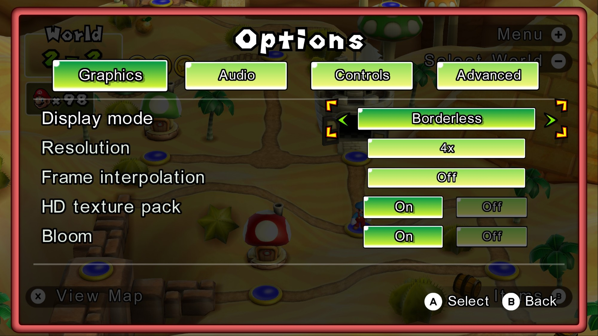
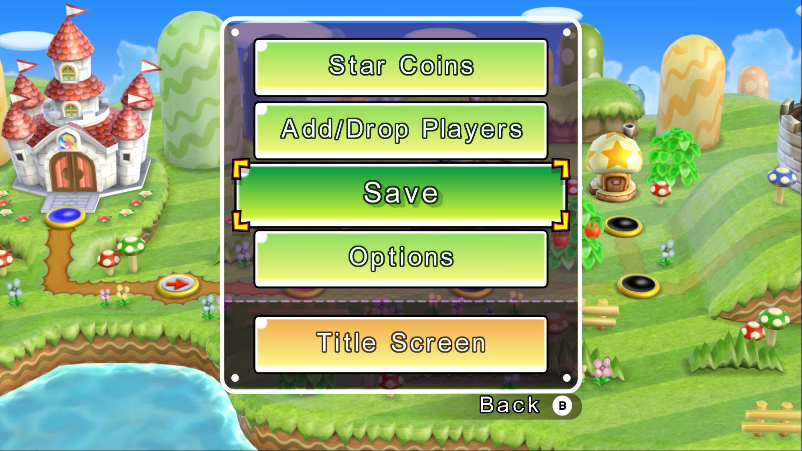
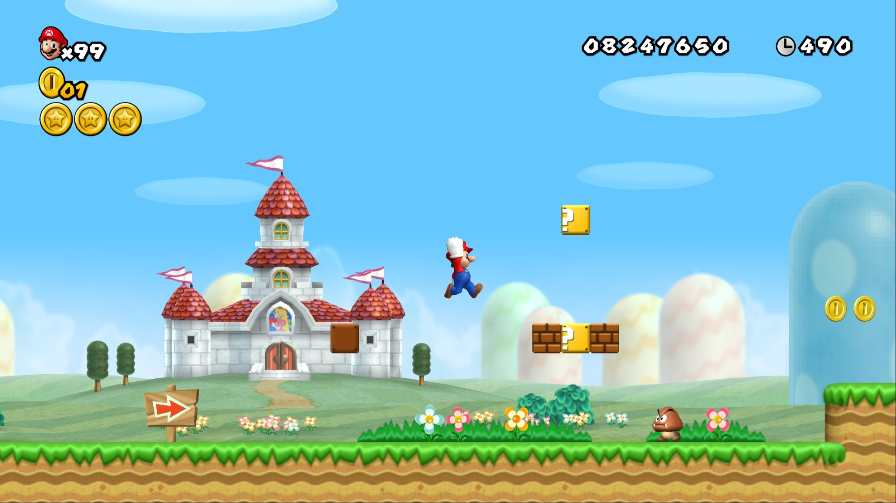
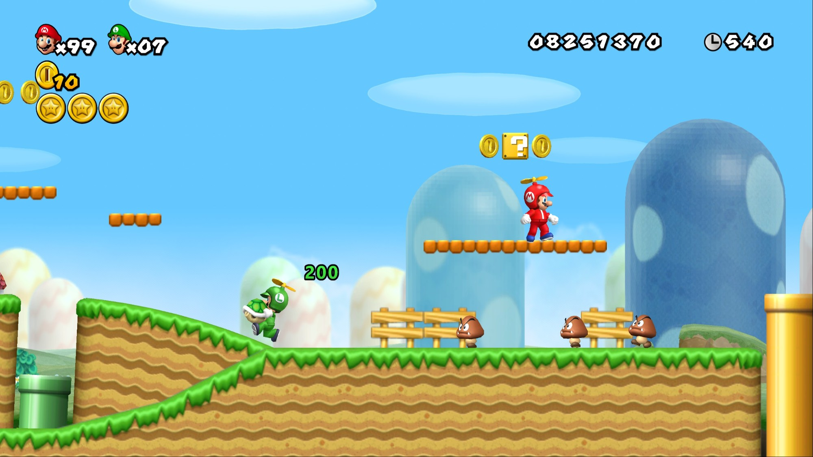
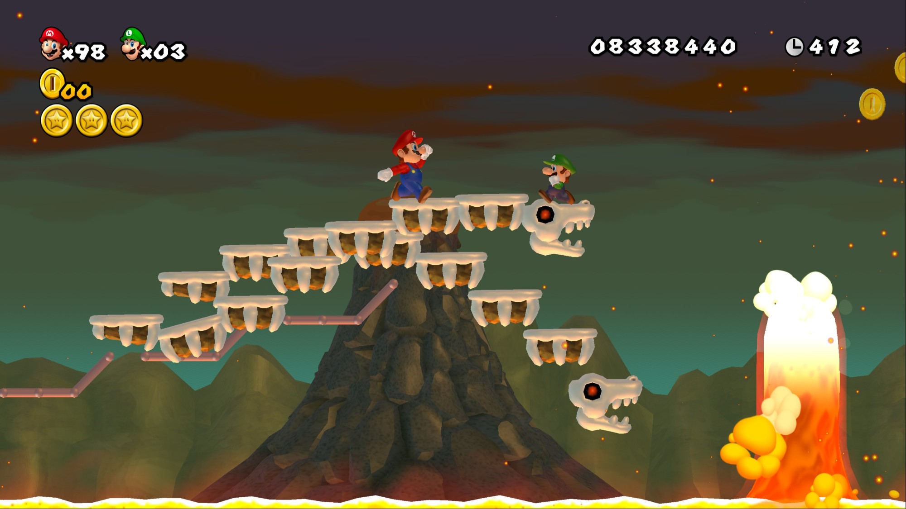
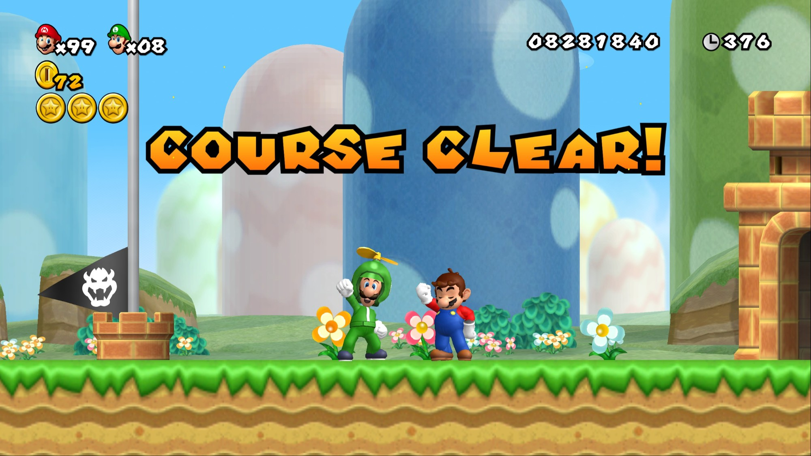
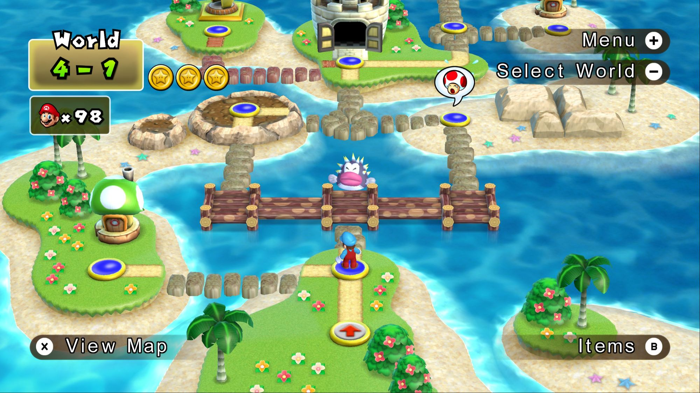
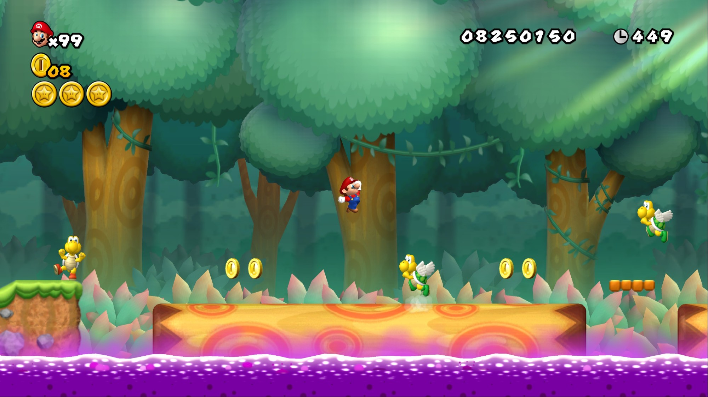

  

---

**New Super Mario Bros. Wii as a native Windows game.** Play in high resolution and widescreen, at up to 180 fps, with keyboard or any gamepad, Dolphin HD texture packs and up to four players. No emulator needed.

  

**[Download the latest release](https://github.com/ral1009/NSMBWiicompiled/releases/latest)**

> [!IMPORTANT]
> This download contains no game assets: no levels, graphics, music or sound. You need your own copy of the game, dumped from the **PAL disc (SMNP01), revision 1**. The US disc will not work. Please don't ask for game files.

## Contents
- [System requirements](#system-requirements)
- [How to install](#how-to-install)
- [Features](#features)
- [Controls](#controls)
- [Known issues](#known-issues)
- [FAQ](#faq)
- [Building from source](#building-from-source)
- [Credits](#credits)

## System requirements
- Windows 10 or 11, 64-bit
- A CPU with AVX2: Intel Haswell (2013) or newer, or any AMD Ryzen
- A GPU with Direct3D 12 or Vulkan; integrated graphics work (see [FAQ](#faq))
- About 1 GB of free space
- Your own dump of the PAL disc as `.rvz`, `.iso` or `.wbfs`. Dolphin's [ripping guide](https://dolphin-emu.org/docs/guides/ripping-games/) explains how to dump a disc from a Wii.

## How to install
1. Download the zip from the [releases page](https://github.com/ral1009/NSMBWiicompiled/releases/latest) and extract all of it into its own folder.
2. Run `NSMBWCompiled.exe`.
3. Pick your disc image when asked. It is extracted once into a `disc` folder next to the game, which takes a few seconds. You can also pick a folder you already extracted with Dolphin.
4. Optionally, pick a Dolphin HD texture pack folder to install it.
5. The options menu opens before the title screen the first time, so you can set resolution, frame rate and controls before playing. Press **F10** to open it again at any time.

Later launches go straight to the game.

## Features

### An options menu that looks like it belongs
Press **F10**, or choose **Options** in the pause menu or the world-map menu. The menu uses the game's own windows, buttons, fonts, animations and sounds.

| | |
|---|---|
|  |  |

**Save** in that world-map menu always does a full save and lets you keep playing, at any point in the game. The original only offers Quick Save, which quits to the title screen, until you beat the final boss.

- **Graphics:** windowed, borderless or fullscreen; resolution from native up to 8x; frame interpolation; HD textures; bloom
- **Audio:** separate volumes for music, sound effects and menu sounds
- **Controls:** pick which controller each player uses, and rebind any button, including to combinations such as L + R
- **Advanced:** FPS counter and a few performance switches

### High resolution and widescreen
Render at up to 8x the Wii's resolution, in 16:9. The game logic still runs at 60 fps like the original. **Frame interpolation** adds in-between frames for 120 or 180 fps on high-refresh monitors.

### HD texture packs
Dolphin texture packs for NSMBW work without changes. Install one during setup, or later by copying it into the game folder, and switch it on or off in the options menu while you play. Tested with *NSMBW HD v2.81* and nymo642's [HD HUD Tweaks](https://gamebanana.com/mods/480785). No packs are included; download them from their authors.

### Keyboard, gamepads and multiplayer
- Every SDL-supported gamepad works: Xbox, PlayStation, Switch Pro and most others.
- Buttons are bound separately for levels, the world map and menus, so jump and confirm can sit on different buttons. A binding can also be a combination: hold the buttons together when binding.
- On-screen button prompts show the buttons you actually press, for the controller you last used.
- Each connected gamepad is a player, up to four, and the keyboard is player 1. Other players can share the keyboard too: set their controller to Keyboard and give them keys of their own.

### Small changes to the game
- **Exit** in the pause menu works in any course, even one you haven't cleared yet.
- **Save** on the world map always saves fully and keeps playing. The original only offers Quick Save until the final boss is beaten.
- The Wii Remote strap and "hold the remote sideways" screens are skipped.
- The opening cutscene and hint movies can be skipped: press **-** once to show the prompt, then again to skip.
- The options menu pauses the whole game, sound and hint-movie replays included.

### Screenshots

| | |
|---|---|
|  |  |
|  |  |

## Controls

Defaults; change them in **Options → Controls**.

| Action | Gamepad | Keyboard |
|---|---|---|
| Jump / confirm | A (Cross) | Z or Space; Enter in menus |
| Run, fireball / back | X / B (Square / Circle) | X; Backspace in menus |
| Spin jump | Shoulder buttons | C |
| Pause | Start | = or Esc |
| Move | D-pad, left stick | Arrow keys |
| Tilt (tilting platforms) | Right stick left / right | A / D |
| Skip cutscene / hint movie (press twice) | Back (-) | - |
| Options menu | Back + Start (- and +) | F10 |
| Switch options tab | LB / RB | Q / E |

## Future Plans
- Support for all game versions beyond the PAL rev 1 disc
- Lower the system requirements, specifically AVX2
- Android, Linux, Mac Support
- Player 1 Character Select

## Known issues
- **Brief stutters the first time you see a new area.** The game ships with shaders prepared for World 1, so later worlds compile some on first visit. They are saved and do not stutter again.
- **6x and 8x are not available with frame interpolation on**, because they ran badly on the hardware tested.
- **No Wii Remote support.** Use a keyboard or gamepad.
- Only the PAL disc, revision 1, is supported.

## FAQ

#### Is this an emulator?
No. The game's code was translated ahead of time into a normal Windows program (static recompilation), the same approach as [WiiCompiled](https://github.com/patchzyy/Wiicompiled) for Mario Kart Wii. The game's assets still come from your disc.

#### Why doesn't my US copy work?
The port is built against the PAL release (SMNP01, revision 1). Other versions have different code, so they would need their own port.

#### Where are my saves and settings?
In `%LOCALAPPDATA%\WiiCompiled\`: settings in `Config.toml`, controls in `nsmbw_controls.ini`, and the save in `NAND\title\00010004\534d4e50\wiimj2d.sav`. To keep everything inside the game folder instead, put an empty file named `portable.txt` next to `NSMBWCompiled.exe`. Saves and settings then go to a `UserData` folder there.

#### It runs slowly on my laptop. What should I change?
Lower the resolution first. On an Intel Iris Xe laptop, 1x and 1.5x hold 180 fps with frame interpolation, 2x holds 120 and 4x holds 60. Keep the game window in front, since a covered window can run noticeably slower.

#### Something broke. Where is the log?
`nsmbw_data\NSMBWCompiled.log` next to the game. Include it if you [open an issue](https://github.com/ral1009/NSMBWiicompiled/issues).

## Building from source
You don't need to build anything to play. To build the port yourself or work on it, see [docs/BUILDING.md](docs/BUILDING.md).

## Credits
- [WiiCompiled](https://github.com/patchzyy/Wiicompiled), the Mario Kart Wii recompilation this port is built on
- [aurora](https://github.com/encounter/aurora), which draws the game's graphics on modern GPUs
- [Dolphin](https://github.com/dolphin-emu/dolphin)'s `DolphinTool`, which extracts your disc image (GPLv2+)
- Button prompt art: [Kenney's Input Prompts](https://kenney.nl/assets/input-prompts) (CC0)
- Repository art (Will be added to game): [POOTERMAN](https://www.deviantart.com/pooterman)

This is a student project, made with AI assistance. Licensed under [GPL-3.0](LICENSE); third-party licenses are in [THIRD-PARTY-NOTICES.md](THIRD-PARTY-NOTICES.md).
